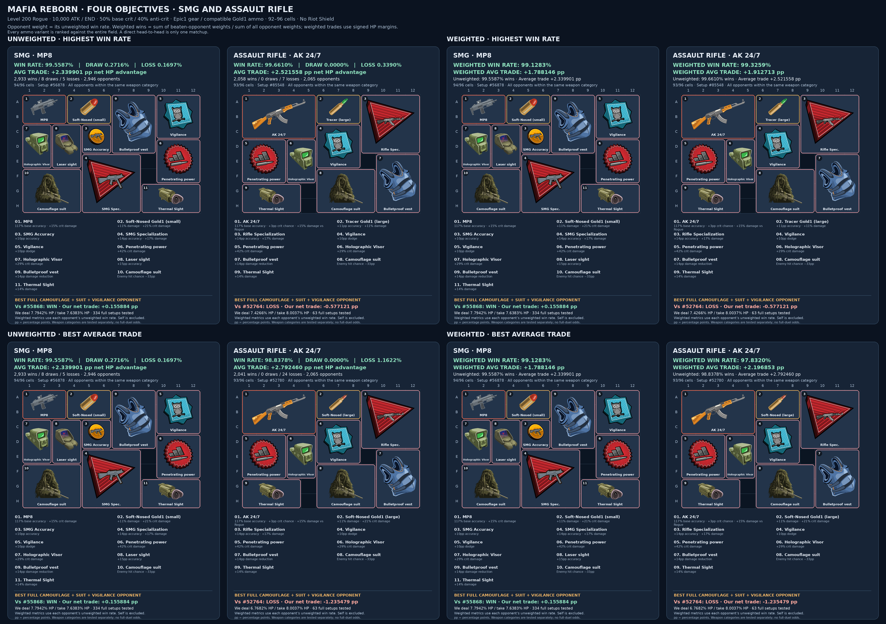

# Mafia Reborn: combat-inventory optimization (Interactive viewer doesnt work yet!)

> **[Open Loadout Lab — interactive inventory and counter explorer](https://EgyipTomi425.github.io/mafia-reborn-loadout-optimizer/)**
>
> Build an enemy inventory, rank all counters, inspect matchup margins, or import a screenshot locally. Rogue only; SMG and AK stay separate.

A reproducible C++/CUDA study of **one-exchange expected HP advantage**. The CPU
enumerates item sets, CUDA proves whether each inventory fits, and every valid
set is compared with every other valid set in its weapon category. This
repository contains the current experiment and its verified results.

# Class Balance & Equipment Rework Suggestion

The main problems with the current class balance are **the Tactician's relatively low base combat value and equipment that disproportionately benefits certain classes.**

## TL;DR – Complete proposed changes

| Stat | Tactician | Rogue | Bully |
|---|---:|---:|---:|
| Damage scaling buff | +9.9748% | +8.4400% | +6.9059% |
| Damage per level (`perLevel`) | 17 → 18.6957 | 8.5 → 9.2174 | 5.1 → 5.4522 |
| HP scaling | 2 → 2.5 | 3.85 → 4 | 4.4 → 5 |
| Base dodge | 7.1% → 10% | 10.1% → 10% | 9.1% → 10% |
| Base DR | 10% | 25% → 30% | 50% |
| Epic spread | 15% | 12% | 9% |
| Fixed base damage | 14 | 0 | 3 |
| Total DR with Epic Vest | 24% → 23.5% | 39% → 40.5% | 64% → 57.5% |

**These damage scaling changes also make Epic weapon levels easy to estimate: round the minimum damage to the nearest multiple of 10 for Tactician, 5 for Rogue or 3 for Bully, then divide by that number (allowing for fixed base damage and random rolls).** **HP would also be easier to calculate with simpler scaling values (2.5, 4 and 5), while base damage reduction would follow a consistent 20-percentage-point progression across the classes (10%, 30% and 50%).**

- Bulletproof Vest: additive +14 percentage points → multiplicative 15% incoming damage reduction.
- Class base dodge: standardized to 10% for all classes. Any changes to the Vigilance item itself can be addressed separately.

## TL;DR – Class balance improvement

Current vs. proposed class strength with all three Epic items equipped (Rogue = 100%):

```text
Tactician
Current   █████                          89.6507%
Proposed  ██████████████                 99.2966%

Rogue
Current   ███████████████               100.0000%
Proposed  ███████████████               100.0000%

Bully
Current   ██████████████████████        107.1234%
Proposed  █████████████████             101.7421%
```

The bars start at 85% to make the differences easier to see.

## 1. Current class balance

**Rogue is the 100% reference in each column.** The numbers compare the classes' damage and survivability with identical equipment, using the game's damage and HP scaling. All columns include an Epic weapon. The relative comparison uses damage scaling rather than the small fixed base damage constants.

| Class | Weapon only | + Vest | + Vigilance | All three | After proposed changes |
|---|---:|---:|---:|---:|---:|
| Tactician | 91.5337% | 89.8317% | 91.3493% | 89.6507% | **99.2966%** |
| Rogue | 100.0000% | 100.0000% | 100.0000% | 100.0000% | **100.0000%** |
| Bully | 100.8591% | 107.1971% | 100.7897% | 107.1234% | **101.7421%** |

The first four columns show the current balance. The last column shows the proposed balance, with or without the reworked 15% Vest and Vigilance, using the current Vigilance bonus. Each item would give the same proportional benefit to every class, so the relative values do not change.

**Without class-dependent equipment effects, Rogue and Bully are already fairly well balanced, while Tactician is significantly weaker than both.** Bully has only a 0.8591% VALUE advantage over Rogue, while Tactician is 8.4663% below Rogue. **Equalizing equipment benefits alone would therefore not solve Tactician's underlying weakness.**

## 2. Bulletproof Vest rework

The current Epic Bulletproof Vest adds 14 percentage points of damage reduction. The higher a class's base damage reduction, the more effective HP it gains from the Vest. In other words, the same item is worth much more to Bully.

| **Class** | **Base DR** | **DR with Vest** | **DR with Reworked Vest** | **Current EHP Bonus** | **Notes** |
|---|---:|---:|---:|---:|---|
| Tactician | 10% | 24% | 23.5% | +18.4211% | No base DR change needed |
| Rogue | 25% | 39% | 36.25% | +22.9508% | **Increasing base DR to 30% is recommended (40.5% total DR with the reworked Vest).** |
| Bully | 50% | 64% | 57.5% | +38.8889% | No base DR change needed |

**Bully receives more than twice the effective HP bonus of Tactician from the very same item.** Beyond being a strong meta item, the Vest's current implementation substantially amplifies Bully's strength. Its VALUE advantage over Rogue rises from 0.8591% to 7.1971%, and its advantage over Tactician rises from 10.1880% to 19.3310%. **With the current Vest, Bully significantly dominates the other classes in this power comparison.**

**Proposal:** Replace the additive 14 percentage points with a multiplicative 15% reduction of incoming damage.

Instead of adding the Vest bonus to base damage reduction, multiply the remaining damage by the Vest's own reduction factor:

- Current: `Damage taken = Damage × (1 − Base DR − 0.14)`
- Proposed: `Damage taken = Damage × (1 − Base DR) × (1 − 0.15)`

For example, Bully would take `Damage × 0.50 × 0.85 = Damage × 0.425`, resulting in 57.5% total damage reduction instead of 64%.

Increasing Rogue's base damage reduction from 25% to 30% would bring its total damage reduction with the reworked Vest to 40.5%, further improving the overall class balance.

**Every class would receive the same +17.6471% effective HP and approximately +8.4652% VALUE.** The Vest would remain a strong defensive item without artificially favoring Bully.

The Vest occupies 12 inventory cells, while many skills occupy 9. To compare their value per inventory space, the table also shows the effective HP bonus scaled to 9 cells (`EHP bonus × 9 / 12`).

| Class | Current Vest EHP (12 cells) | Current EHP per 9 cells | Reworked Vest EHP (12 cells) | Reworked EHP per 9 cells |
|---|---:|---:|---:|---:|
| Tactician | +18.4211% | +13.8158% | **+17.6471%** | **+13.2353%** |
| Rogue | +22.9508% | +17.2131% | **+17.6471%** | **+13.2353%** |
| Bully | +38.8889% | +29.1667% | **+17.6471%** | **+13.2353%** |

The 9-cell values are a simple space-adjusted comparison, not a change to the Vest's actual size or in-game bonus. The proposed 15% reduction also applies after Rogue's recommended base DR increase.

**This fixes both the class-dependent advantage and reduces the Vest's dominance as a meta item.** With this item reform alone, Rogue and Bully would remain close to their original near-balanced relationship, while Tactician would still need a separate class buff.

## 3. Class base dodge rework

Epic Vigilance adds 10 percentage points of dodge chance. Classes that already have more dodge get a bigger survivability boost from the same item.

| Class | Base dodge | Dodge with Vigilance | Effective HP bonus |
|---|---:|---:|---:|
| Tactician | 7.1% | 17.1% | +12.0627% |
| Rogue | 10.1% | 20.1% | +12.5156% |
| Bully | 9.1% | 19.1% | +12.3609% |

This imbalance is much smaller than the Vest's, but **Vigilance still favors Rogue and benefits Tactician the least.** **The underlying Rogue–Bully balance is already close; Tactician remains considerably weaker than both.**

**Proposal:** Standardize base dodge to 10% for all classes. This change targets the classes’ innate dodge chance, not the Vigilance item itself. **With the current Epic Vigilance bonus, every class would then have 20% dodge, gaining exactly +12.5% effective HP and approximately +6.0660% VALUE from the item.** Any future changes to Vigilance can be considered separately.

## 4. Weapon damage adjustments

The goal is to bring Epic weapon minimum damage per level to 10 for Tactician, 5 for Rogue and 3 for Bully, without changing their existing damage spreads or fixed base damage.

| Class | Old scaling | Proposed scaling | Scaling buff |
|---|---:|---:|---:|
| Tactician | 17 | 18.6957 | +9.9748% |
| Rogue | 8.5 | 9.2174 | +8.4400% |
| Bully | 5.1 | 5.4522 | +6.9059% |

The new scaling values are rounded upwards to four decimal places. The displayed percentage buffs are calculated from these rounded values and also rounded upwards to four decimal places.

| Class | Epic spread | Min/level | Max/level | Average/level |
|---|---:|---:|---:|---:|
| Tactician | 15% | 10 | 11.50 | 10.750 |
| Rogue | 12% | 5 | 5.60 | 5.300 |
| Bully | 9% | 3 | 3.27 | 3.135 |

These are the target damage ranges per level, before fixed base damage and random rolls.

**Example: level 100 Epic 1 weapons**

Here is what a typical level 100 Epic weapon would look like, including fixed base damage:

| Class | Current range | Proposed range | Current mean | Proposed mean |
|---|---:|---:|---:|---:|
| Tactician | 916–1055 | 1007–1159 | 985.5 | 1083 |
| Rogue | 461–516 | 500–560 | 488.5 | 530 |
| Bully | 282–308 | 301–329 | 295 | 315 |

## 5. Complete proposed changes

| Stat | Tactician | Rogue | Bully |
|---|---:|---:|---:|
| Damage scaling buff | +9.9748% | +8.4400% | +6.9059% |
| Damage per level (`perLevel`) | 17 → 18.6957 | 8.5 → 9.2174 | 5.1 → 5.4522 |
| HP scaling | 2 → 2.5 | 3.85 → 4 | 4.4 → 5 |
| Base dodge | 7.1% → 10% | 10.1% → 10% | 9.1% → 10% |
| Base DR | 10% | 25% → 30% | 50% |
| Epic spread | 15% | 12% | 9% |
| Fixed base damage | 14 | 0 | 3 |
| Total DR with Epic Vest | 24% → 23.5% | 39% → 40.5% | 64% → 57.5% |

- Bulletproof Vest: additive +14 percentage points → multiplicative 15% incoming damage reduction.
- Class base dodge: standardized to 10% for all classes. Any changes to the Vigilance item itself can be addressed separately.

## 6. Class balance improvement

Current vs. proposed class strength with all three Epic items equipped (Rogue = 100%):

```text
Tactician
Current   █████                          89.6507%
Proposed  ██████████████                 99.2966%

Rogue
Current   ███████████████               100.0000%
Proposed  ███████████████               100.0000%

Bully
Current   ██████████████████████        107.1234%
Proposed  █████████████████             101.7421%
```

The bars start at 85% to make the differences easier to see.

With only Epic weapons equipped, the strongest class currently has a 10.19% relative VALUE advantage over the weakest. With all three items equipped, that advantage rises to 19.49%. **After the proposed changes, it falls to just 2.46% regardless of whether everyone equips Vest or Vigilance.**

**The proposal closes 75.83% of the original weapon-only balance gap and 87.36% of the gap with all three items equipped.**

Although the relative balance is the same with or without the reworked Vest, the actual power of each class changes. Compared with its own current strength using the same equipment:

| Class | VALUE change (weapon only) | VALUE change (all three items) |
|---|---:|---:|
| Tactician | +19.1209% | +18.9624% |
| Rogue | +9.8082% | +7.4062% |
| Bully | +10.7695% | +2.0107% |

The goal is not necessarily perfect mathematical equality. **A small remaining VALUE advantage for the tankier class may be reasonable because less tanky, high-damage classes can have more volatile fight outcomes.** Favorable critical hits, damage rolls, dodge rolls or initiative may allow them to win some fights against stronger opponents. Conversely, unfavorable rolls can hurt them as well.

A small gap is a reasonable starting point, and actual fights can show whether further adjustments are needed.

## Conclusion

The changes preserve the identities of all three classes: Tactician as the high-damage class, Rogue as the balanced class, and Bully as the tank. They address Tactician's underlying disadvantage and remove the equipment mechanics that artificially exaggerate class differences. **The resulting theoretical VALUE gap is only around 2.46%, regardless of whether everyone equips Vest and Vigilance.**

These are theoretical power estimates, not duel win rates.


## 7. Optional item balance suggestions – more creativity, less meta

These suggestions are separate from the class balance changes above. **They can be ignored without affecting the main proposal.** However, it would be more interesting if creativity and situational builds mattered more than simply equipping the same meta items in every fight.

**A few general balancing principles:**

- **Inventory space is not the whole story.** Larger items are harder to fit into a build, even when their bonus per tile is similar. Their footprint and shape should also be considered when balancing them.
- **Prefer clean, round numbers in item descriptions** whenever possible. Values such as 8%, 10%, 15%, 30% and 50% are easier to remember, compare and build around.
- **Gamble-based items should generally have a slightly lower expected bonus than comparable reliable items.** Their appeal should come from the chance of a high-impact roll that can swing a fight, rather than also offering the best average value. This is a design preference, not a mathematical rule for every random effect.

The reworked Vest is a useful reference: it occupies 12 tiles and provides **+17.6471% effective HP**, equivalent to **+13.2353% per 9 tiles** using a simple space-adjusted comparison. For critical damage items, assume maximum opposing Toughness (40% anti-crit), leaving 30% effective critical chance from a 50% base chance, with a 2× base critical damage multiplier. For Vigilance, both columns assume the proposed 10% class base dodge.

### Suggested Epic item adjustments

| Item | Tiles | Current effect | Proposed effect | Current effective bonus | Proposed effective bonus | Proposed bonus per 9 tiles |
|---|---:|---|---|---:|---:|---:|
| Bulletproof Vest (reference) | 12 | +14 pp additive DR | 15% multiplicative DR | Class-dependent (see Section 2) | +17.6471% EHP | +13.2353% EHP |
| Vigilance | 9 | +10 pp dodge | **+8 pp dodge** | +12.5000% EHP | +9.7561% EHP | +9.7561% EHP |
| Rapid Fire | 9 | 17% chance for 10–20% extra damage | **30% chance for 30% extra damage** | +2.5500% DMG | +9.0000% DMG | +9.0000% DMG |
| Thermal Imaging Telescopic Sight (green) | 8 | +14% damage | **+10% damage** | +14.0000% DMG | +10.0000% DMG | +11.2500% DMG |
| Penetrating Power | 9 | +42 pp critical damage | +42 pp critical damage | +9.6923% DMG | +9.6923% DMG | +9.6923% DMG |
| Holographic Visor | 6 | +29 pp critical damage | +29 pp critical damage | +6.6923% DMG | +6.6923% DMG | +10.0385% DMG |
| **Medic!** | 9 | +14 pp max HP per heal | **+50% healing per item (multiplicative)** | Item-dependent* | **6 / 9 extra healing tiles** | **6 / 9 extra healing tiles** |

EHP means effective HP; DMG means average effective damage. The tile-adjusted bonus is the item's bonus multiplied by 9 and divided by its inventory size. These are comparable offensive or defensive bonuses, not direct VALUE increases or duel win rates. Rapid Fire's damage estimate excludes the lethal-hit restriction, and the scope and crit calculations assume no other damage or critical damage bonuses.

**Vigilance, Rapid Fire and Penetrating Power would all be worth around 9–10% effective HP or damage per 9 tiles.** The Thermal Sight would remain competitive without being as dominant as before. The 15% Vest would still be a strong defensive choice, but the gap between it and alternative items would be smaller.

### Rifle and Sniper Accuracy skills

The 3×3 weapon-specific Accuracy skills for assault rifles (including AK) and sniper rifles currently provide only +10 percentage points of accuracy. **They should provide at least +15 percentage points to have a reasonable chance of being useful.** Even then, their 9-tile footprint makes them difficult to justify against the 8-tile Tactical Telescopic Sight, which already provides +15 percentage points of accuracy, where both can be equipped. The actual damage benefit depends on the opponent's hit-chance reduction and the 100% accuracy cap.

### Medic! – healing-focused builds (3×3 / 9 tiles)

**With a multiplicative 50% healing bonus, Medic would be worth 6 / 9 extra healing tiles when using two / three 6-tile healing items.** In other words, it would provide the healing equivalent of one / one and a half additional healing items of the same average strength.

This comparison does not require a specific healing amount: it simply multiplies the occupied healing-item tiles (12 / 18) by 50%. Actual healing still depends on triggering and overhealing.

*The current +14 percentage-point bonus is additive in the client code, so its actual tile-equivalent value depends on the healing items used. The proposed multiplicative effect is a rework and is not necessarily stronger in every setup.*

**Healing items are already strong on their own. The idea is to make Medic more appealing, not to buff the healing items themselves.** It could be fun to test a dedicated healing build as an alternative to the standard meta.

## 8. Optional new item idea – Randuin (3×3 / 9 tiles)

**Reduce the total damage taken from critical hits by 20%.** Normal hits are unaffected. For example, a critical hit that would deal 1,000 damage would deal 800 instead.

Randuin would offer an alternative for players who prefer not to invest heavily in Toughness (TN). **It should outperform an average 9-tile item when the player has no TN and faces a high-crit opponent, but become less valuable as effective enemy crit chance falls.**

| Enemy effective crit chance | EHP bonus (no crit damage items, 2× crit) | EHP bonus (2 crit damage items, 2.71× crit) |
|---:|---:|---:|
| 50% | +15.3846% | +17.1086% |
| 40% | +12.9032% | +14.7764% |
| 30% | +10.1695% | +12.0409% |

The two-item example assumes Epic Penetrating Power (+42 percentage points) and Holographic Visor (+29 percentage points), with no other critical damage bonuses. The listed crit chances are the actual chances after any anti-crit effects. Since Randuin occupies 9 tiles, the listed bonuses are also its bonuses per 9 tiles.

Against an enemy with 50% crit chance and a 2× critical multiplier, Randuin provides +15.3846% EHP, matching maximum TN in this particular expected-damage model. Against the two crit damage items, maximum TN provides +22.6041% EHP, exceeding Randuin. **Randuin consumes 9 inventory tiles and reduces critical damage, while TN reduces the frequency of critical hits.** The 20% proposal is intended as a strong situational option rather than a universally superior replacement for TN.

Source: https://github.com/EgyipTomi425/mafia-reborn-loadout-optimizer

## 1. Class comparison: coefficients, value, and interpretation

The supplied normalized comparison is reproduced by a **level-50 reference
scenario with nominal Epic1 weapons and Epic Vigilance on every class**:

| Class | ATTACK | END | COMBAT | VALUE |
|---|---:|---:|---:|---:|
| Tactician | 2.033× | 0.417× | 84.8% | 0.921× |
| Rogue | 1.000× | 1.000× | 100.0% | 1.000× |
| Bully | 0.607× | 1.693× | 102.8% | 1.014× |

For normalized attack and endurance coefficients $a_c$ and $e_c$, the columns use

```math
\mathrm{COMBAT}_c=100a_ce_c\%,\qquad
\mathrm{VALUE}_c=\sqrt{a_ce_c}.
```

Calculations use the full-precision reconstructed coefficients before rounding
the displayed columns.

VALUE is the geometric-mean scale of the attack–endurance product. Thus Bully's
supplied VALUE is approximately **1.4% above Rogue**, while its product-based
COMBAT score is approximately **2.8% higher**. These are different quantities;
neither is a duel win probability. Bully has a small, steady advantage in this
reference proxy, while Rogue can still win individual fights through favorable
hit, dodge, critical, and damage rolls.

Tactician should **not be classified as generally weaker from this table alone**.
It describes a normalized coefficient comparison, not the complete progression
process. A Tactician can obtain favorable wins against stronger opponents and,
where those wins improve its rewards, acquire better equipment. Such a gear
advantage can reverse an equal-level comparison. This progression argument is
outside the present fixed-equipment analysis; the experiment does not measure
loot acquisition or establish that a class necessarily progresses faster.

### 1.1 Reconstructing the setup behind the reference numbers

Let $h_c$ be the class HP multiplier, $\rho_c$ its base mitigation, $d_c$ its
base dodge, and $\mu_{R,c}$ the mean of its nominal generated weapon range.
The following reconstruction matches **every supplied column at its displayed
precision**:

```math
a_c=\frac{\mu_{R,c}}{\mu_{R,\mathrm{Rogue}}},\qquad
e_c=\frac{h_c/[(1-\rho_c)(1-d_c-0.10)]}
{h_{\mathrm{Rogue}}/[(1-\rho_{\mathrm{Rogue}})(1-d_{\mathrm{Rogue}}-0.10)]}.
```

The 0.10 is **Epic Vigilance**, applied to every class. The matching setup uses
level 50, nominal Epic1 generation with both random generation factors set to
one, and no Vest, Camouflage, Suit, ammo, or other class-dependent buffs. A concrete
matching example uses **1,000 raw Attack and 1,000 raw Endurance**, 50% base crit,
and 40% anti-crit for every class. A common generic SMG category is sufficient:
common accuracy and critical factors cancel. The raw Attack/Endurance scales
cancel in this proxy; these values specify a reproducible matching example,
not uniquely recovered historical inputs. This is an analytical class proxy,
not a 92–96-cell inventory candidate or a complete-fight measurement.

Without Vigilance, level-50 END becomes **0.418921×** for Tactician and
**1.695427×** for Bully, rather than **0.417235×** and **1.693096×**. Vigilance
therefore genuinely changes the comparison. The reconstruction identifies a
consistent setup; the original historical execution log was not supplied.

Keeping Vigilance and repeating the same calculation at **level 200** gives:

| Class | ATTACK | END | COMBAT | VALUE |
|---|---:|---:|---:|---:|
| Tactician | 2.008184× | 0.417235× | 83.7884% | 0.915360× |
| Rogue | 1.000000× | 1.000000× | 100.0000% | 1.000000× |
| Bully | 0.601535× | 1.693096× | 101.8455% | 1.009186× |

Thus the approximately **1.4% Bully VALUE advantage belongs to the reconstructed
level-50 comparison**. At level 200, the same nominal proxy gives about **0.92%**.
The weapon generator's class-dependent additive constants make ATTACK depend on
level. These proxy tables do not change the level-200 Rogue inventory results.

The supplied rounded inputs remain in
[`data/class_reference.json`](data/class_reference.json). A source-based
reconstruction, including the with/without-Vigilance alternatives, is generated
as [`results/class_mechanics.json`](results/class_mechanics.json).

### 1.2 What a skill point buys in each class

The following constants are extracted from the bundled client, independently
of the supplied normalized table:

| Class | HP multiplier $h_c$ | Base dodge | With Epic Vigilance | Base mitigation | With Epic Vest | HP per Endurance at level 200, continuous |
|---|---:|---:|---:|---:|---:|---:|
| Tactician | 2.00 | 7.1% | 17.1% | 10% | 24% | 402.00 |
| Rogue | 3.85 | 10.1% | 20.1% | 25% | 39% | 773.85 |
| Bully | 4.40 | 9.1% | 19.1% | 50% | 64% | 884.40 |

Vigilance and Vest are optional in the inventory search. Their columns above
show the effect **when equipped**, not universal base stats. The exact HP formula
with an Endurance stat buff $b_E$ is

```math
E_{\mathrm{eff}}=\left\lceil E(1+b_E)\right\rceil,\qquad
H_c(E)=\left\lceil E_{\mathrm{eff}}(\ell+1)h_c\right\rceil.
```

The exact one-point increment is $H_c(E+1)-H_c(E)$. Without buffs, the continuous
increment is $k_c=(\ell+1)h_c$ and the integer increment is either
$\lfloor k_c\rfloor$ or $\lceil k_c\rceil$. At level 200 and 10,000 Endurance:

| Class | HP at 10,000 Endurance | Exact HP gained by the next Endurance point |
|---|---:|---:|
| Tactician | 4,020,000 | 402 |
| Rogue | 7,738,500 | 774 |
| Bully | 8,844,000 | 885 |

Endurance raises HP; it does not directly raise dodge or mitigation. A useful
survival proxy against normalized, noncritical incoming attempts with hit chance
one is

```math
\mathrm{EHP}_c=\frac{H_c}{(1-d_c-v)(1-\rho_c)},\qquad
\frac{\partial\mathrm{EHP}_c}{\partial E}
\approx\frac{(\ell+1)h_c}{(1-d_c-v)(1-\rho_c)}.
```

Here $v$ is the equipped Vigilance bonus, and the displayed example has no Vest.
This proxy incorporates expected dodge and mitigation; it is not an exact number
of attacks survived. It ignores the two-damage floor and critical variance.

| Class | Effective HP per Endurance, no Vigilance | Effective HP per Endurance, Epic Vigilance |
|---|---:|---:|
| Tactician | 480.803732 | 538.801769 |
| Rogue | 1,147.719689 | 1,291.364205 |
| Bully | 1,945.874587 | 2,186.402967 |

### 1.3 How class and weapon generation determine Attack's value

The Attack multiplier itself is shared across classes:

```math
A_{\mathrm{eff}}=\left\lceil A(1+b_A)\right\rceil,\qquad
K_A=0.055A_{\mathrm{eff}}(1+b_{\mathrm{damage}}-b_{\mathrm{damageDebuff}}).
```

The class changes the **generated weapon range**, not the constant 0.055.
For generation quality multiplier $q$, class parameters $p_c,b_c$, generation
rolls $U\in[0.99,1.01]$ and $V\in[0.9,1.1]$, and class/quality spread $s_c$:

```math
S_c=(p_c\ell+b_c)qU,\qquad s=s_cV.
```

```math
R_{\min}=\left\lfloor\frac{S_c}{2+s}\right\rfloor.
```

```math
R_{\max}=\mathrm{round}(S_c)-R_{\min}.
```

Combat samples the equipped weapon's **stored** integer range. It does not add
another class damage multiplier to a range that was already generated for a
class. Epic1 uses $q=1.15$ and 117% base accuracy for all three classes.

| Class | $p_c$ per level | $b_c$ additive constant | Epic1 spread $s_c$ | Nominal level-200 Epic1 range | Mean roll $\mu_R$ | Continuous noncritical damage per Attack point |
|---|---:|---:|---:|---:|---:|---:|
| Tactician | 17.0 | 14 | 0.15 | 1,826–2,100 | 1,963.0 | 107.9650 |
| Rogue | 8.5 | 0 | 0.12 | 922–1,033 | 977.5 | 53.7625 |
| Bully | 5.1 | 3 | 0.09 | 562–614 | 588.0 | 32.3400 |

This table sets $U=V=1$ and excludes hit failures, crit, ammo, other damage buffs,
target-specific bonuses, mitigation, and final rounding. The last column is
$0.055\mu_R$, not a claim that every additional Attack point deals that exact
integer damage in every matchup.

**Proposition — the conditional mean is independent of spread.** The generator
defines $R_{\min}+R_{\max}=\mathrm{round}(S_c)$. A uniform integer random
variable over an inclusive interval has mean $(R_{\min}+R_{\max})/2$. Hence

```math
\mathbb{E}[R\mid S_c,s]=\frac{\mathrm{round}(S_c)}{2}.
```

For a fixed $S_c$, spread can change the range and variance, but not its mean.
The mean remains sensitive to the generation roll $U$ and to rounding $S_c$.

For fixed equipment and probability factors, the continuous expected damage
gain from one additional raw Attack point is

```math
\frac{\partial\mathbb{E}[D]}{\partial A}
\approx p_{\mathrm{land}}\,0.055(1+b_A)
(1+b_{\mathrm{damage}}-b_{\mathrm{damageDebuff}})\mu_R
[1+p_{\mathrm{crit}}(m-1)](1+b_{\mathrm{vsClass}})
(1-\rho_d-b_{\mathrm{resistance}}-b_{\mathrm{defense}})\eta,
```

where $\rho_d$ belongs to the **defender**, $m$ is the critical multiplier, and
$\eta=50/[50+\max(0,\ell_d-\ell_a)]$ is the level penalty. This approximation
assumes the damage floor and lethal-hit Rapid-Fire conditions do not change.
The exact discrete gain is obtained by averaging
$D(A+1,R,C)-D(A,R,C)$ over the same integer rolls and critical branches, with the
client's rounding operations retained. At 10,000 Attack, the rounded mean gains
before defense/crit are approximately **107.963636**, **53.767857**, and
**32.339623**, illustrating the difference from the continuous slopes above.

### 1.4 Weapon-type effects and the other skill points

These are the generic **Epic1** weapon-type bonuses in the bundled generator;
named special weapons may override them:

| Weapon type | Extra crit chance | Extra critical damage | Damage against target classes |
|---|---:|---:|---|
| Pistol | — | +15% | — |
| SMG | — | +15% | — |
| Shotgun | — | +25% | +15% vs Tactician; −15% vs Bully |
| Assault rifle | +3 pp | — | +15% vs Rogue; −15% vs Tactician |
| Sniper | +5 pp | — | +15% vs Bully; −15% vs Rogue |

The same raw Luck or Toughness point has the same base formula in every class.
Its combat benefit then depends on the opponent and equipped weapon:

| Raw point | Continuous benefit before its base cap, no stat buff | Level-200 value |
|---|---|---:|
| +1 Luck | $100/(40.38\ell)$ pp base crit | +0.01238237 pp |
| +1 Luck against 40% anti-crit | $100(1-0.40)/(40.38\ell)$ pp effective crit | +0.00742942 pp |
| +1 Toughness | $100/(44.27\ell)$ pp anti-crit | +0.01129433 pp |
| +1 Toughness against 50% attacker crit | $100(0.50)/(44.27\ell)$ pp less effective enemy crit | −0.00564717 pp enemy crit |

These are uncapped continuous slopes, not extra percentages of total damage.
Luck does not increase accuracy, and Toughness does not add class damage
mitigation. The client also has a separate temporary `defenseBuffPerc`: it adds
direct mitigation and adds anti-crit multiplied by $1+\rho_c$. Epic Bulletproof
Vest uses `damageResistancePerc`, so it does **not** receive that extra anti-crit
effect. No such temporary defense buff is active in the measured run.

## 2. Skill-point allocation: what can actually be proved

Let $A$ denote Attack and $E$ Endurance. With level, equipment, critical statistics,
and the opponent fixed, mean outgoing damage is approximately proportional to
$A$, while HP is proportional to $E$. Integer rounding is temporarily omitted
for the continuous derivations below.

### 2.1 A balanced allocation maximizes an attack–survival product

**Theorem — 50/50 is optimal for the expected exchange ratio under a fixed
equal-cost Attack/Endurance budget.** Assume fixed level, equipment, opponent,
and critical statistics, with expected outgoing damage $kA$, incoming damage
$d>0$, own HP $hE$, and fixed enemy HP $H_e$. The normalized exchange ratio is

```math
\mathcal{R}(A,E)=\frac{kA/H_e}{d/(hE)}=\frac{kh}{dH_e}AE.
```

Thus the product objective is mechanically justified for this ratio. Absorbing
all fixed factors into a positive constant gives the product proxy

```math
F(A,E)=K\,a_cA\,e_cE,
\qquad A+E=P,\quad A,E>0,
```

substitution gives $F(A)=Ka_ce_cA(P-A)$. Therefore

```math
\frac{dF}{dA}=Ka_ce_c(P-2A),\qquad \frac{d^{2}F}{dA^{2}}=-2Ka_ce_c<0,
```

so the unique interior optimum is

```math
A_{\mathrm{opt}}=E_{\mathrm{opt}}=\frac{P}{2}.
```

This is a global maximum: the second derivative is negative over the entire
feasible interval. Equivalently,

```math
AE=\frac{(A+E)^2-(A-E)^2}{4}
=\frac{P^2}{4}-\frac{(A-E)^2}{4}\leq\frac{P^2}{4},
```

with equality only at $A=E$. The identity supplies a second proof independent of
the stationary-point calculation. With integer points, the optimal pair is
$\lfloor P/2\rfloor,\lceil P/2\rceil$, in either order.

Writing $A=fP$ gives the exact relative sensitivity $F/F_{\max}=4f(1-f)$:

| Attack / Endurance allocation | Product value relative to the optimum |
|---|---:|
| 50% / 50% | 100% |
| 55% / 45% | 99% |
| 60% / 40% | 96% |
| 70% / 30% | 84% |
| 80% / 20% | 64% |

Constant class multipliers change the attained value, but not this equal-cost
allocation. If one stat point costs $c_A$ and the other $c_E$, with
$c_AA+c_EE=P$, the corresponding result is

```math
A_{\mathrm{opt}}=\frac{P}{2c_A},\qquad E_{\mathrm{opt}}=\frac{P}{2c_E}.
```

This means equal spending, rather than necessarily equal raw stat points. With
existing effective stats $A_0,E_0$ and $x+y=P$ additional equal-cost points,
maximizing $(A_0+x)(E_0+y)$ gives
$x_{\mathrm{opt}}=(P+E_0-A_0)/2$, clipped to $[0,P]$. The unconstrained solution equalizes
the final effective stats.

**Scope of the proof:** this is an attack–survival product, also proportional to
an expected damage-exchange ratio under the stated assumptions. It is not a
proof that 50/50 maximizes every PvP objective.

### 2.2 The single-exchange HP margin has a different allocation optimum

Against a fixed opponent, with fixed accuracy, mitigation, and critical factors,
write outgoing expected damage as $kA$ and incoming expected damage as $d$.
If our HP is $hE$, the measured HP-percentage margin has the continuous form

```math
M(A,E)=\alpha A-\frac{\beta}{E}.
```

```math
\alpha=\frac{100k}{H_{\mathrm{enemy}}},\qquad \beta=\frac{100d}{h}.
```

With $A+E=P$:

```math
M(A)=\alpha A-\frac{\beta}{P-A}.
```

```math
\frac{dM}{dA}=\alpha-\frac{\beta}{(P-A)^{2}}.
```

```math
\frac{d^{2}M}{dA^{2}}=-\frac{2\beta}{(P-A)^{3}}<0.
```

The interior solution is therefore

```math
E_{\mathrm{opt}}=\sqrt{\frac{\beta}{\alpha}},\qquad A_{\mathrm{opt}}=P-E_{\mathrm{opt}}.
```

It must be clipped to the permitted stat bounds. This derivation assumes that
changing HP does not cross a lethal-hit/Rapid-Fire threshold and that the other
combat factors remain fixed. It shows why **equal Attack and Endurance is not a
universal optimum for the HP-margin objective**. The measured inventory run fixes
both at 10,000; it does not optimize skill points.

For example, take $P=20,000$, $\alpha=0.001$, and $\beta=40,000$. The margin
optimum has $E_{\mathrm{opt}}\approx6,324.555$ and $A_{\mathrm{opt}}\approx13,675.445$. It scores about
**7.350889 pp**, whereas 10,000/10,000 scores **6 pp**. This is an algebraic
counterexample, not a new inventory measurement. It disproves a universal
50/50 claim for the net-margin objective while leaving the ratio theorem intact.

The theory test checks the square identity and every integer allocation for
budgets 2 through 250, verifies unequal-cost examples, and compares the margin
optimum with an exhaustive integer search. These checks validate the algebraic
implementation; the proofs themselves are the derivative and identity arguments.

### 2.3 Luck and Toughness: caps and marginal returns

The bundled client uses, without stat buffs,

```math
c(L)=\min\!\left(0.5,\frac{\lceil L\rceil}{40.38\ell}\right)
       +b_{\mathrm{crit}},\qquad
u(T)=\min\!\left(0.4,\frac{\lceil T\rceil}{44.27\ell}\right),
```

where $\ell$ is character level, $L$ Luck, $T$ Toughness, and $u$ anti-crit.
At level 200, integer stats reach the **base** caps at **4,038 Luck** and
**3,542 Toughness** under the exact-decimal mathematical formula, provided there
are no corresponding stat buffs. There is a small implementation edge case:
binary floating-point evaluation of `40.38 * 200` places the result just above
8,076, so 4,038 Luck yields a probability less than 0.5 by less than $10^{-15}$;
**4,039** strictly saturates that floating-point expression. The theory test
records both thresholds. This inventory experiment directly fixes base crit at
50%, so the edge case does not affect its measured results. Weapon
critical-chance bonuses are added after the base cap.

For a landed shot with critical multiplier $m$, expected critical scaling is

```math
G=1+c(L)(1-u_{\mathrm{enemy}})(m-1).
```

Ignoring the ceilings inside an uncapped interval and defining
$q=(1-u_{\mathrm{enemy}})(m-1)$ gives

```math
\frac{\partial\log F}{\partial L}
=\frac{q}{40.38\ell\,[1+q\,c(L)]}.
```

For fixed enemy crit chance $c_e$ and multiplier $m_e$, let
$r=c_e(m_e-1)$. The expected incoming critical factor is
$J=1+r(1-u(T))$. For a product proxy containing survival $1/J$:

```math
\frac{\partial\log F}{\partial T}
=\frac{r}{44.27\ell\,[1+r(1-u(T))]}.
```

Additional Luck or Toughness has zero marginal benefit **through these base
formulas** beyond its cap. Before the cap, the correct choice depends on the
opponent and the critical multiplier. An interior constrained allocation must
equalize marginal gain per point cost:

```math
\frac{1}{c_x}\frac{\partial\log F}{\partial x}=\lambda.
```

Bounds and caps must also be checked. There is no opponent-independent proof
that one should always fill both caps before buying Attack or Endurance.
[`tests/check_theory.py`](tests/check_theory.py) checks the reference arithmetic,
allocation examples, cap thresholds, and basic combat identities.

### 2.4 Which statements are proved, reconstructed, or measured?

| Claim | Status and evidence |
|---|---|
| Class HP, dodge, mitigation, weapon-generation parameters, and generic weapon bonuses | Extracted from the bundled client and checked by `tools/class_math.py`. |
| The supplied 2.033 / 0.417 / 0.607 / 1.693 class coefficients | Reproduced to displayed precision by the level-50 Epic1 + Vigilance reference context; this does not uniquely recover the historical execution. |
| Conditional weapon-roll mean is `round(S)/2` | Exact consequence of the inclusive uniform mean and the generator's endpoint-sum identity. |
| 50/50 maximizes the fixed-budget expected exchange ratio | Exact continuous theorem under the stated fixed-factor/equal-cost assumptions; integer optimum is the floor/ceiling split. |
| 50/50 maximizes the study's net HP margin in general | False: the derivative gives a different optimum, and a concrete counterexample is checked numerically. |
| The selected inventories maximize the four implemented objectives within this item scope | Exhaustive finite-model search: all candidates covered, every packing status resolved, and all scores independently reconstructed. This is not a proof of optimality for unrestricted live gameplay. |
| Tactician's favorable wins can produce a progression/gear advantage | A conditional progression argument, not a result measured by this fixed-stat experiment. |

The packing proof and allocation identities are mathematical arguments. The
audits validate their implementation and the finite numerical calculation;
they are not substitutes for the stated assumptions. The class and inventory
results remain tied to the bundled client snapshot.

## 3. The measured experiment

| Parameter | Value |
|---|---|
| Both characters | Level 200 Rogue |
| Attack / Endurance | 10,000 / 10,000 |
| HP | 7,738,500 |
| Base crit / anti-crit | 50% / 40% |
| Base dodge / mitigation | 10.1% / 25% |
| Weapons | Epic1 MP8; Epic1 AK 24/7 |
| Skills and accessories | Epic1, compatible items only; Riot Shield excluded |
| Ammunition | None, Gold1 Tracer, or Gold1 Soft-Nosed; at most one |
| Caliber | Small for SMG; large for AK/rifle |
| Inventory | 12×8; 92–96 occupied cells; no rotation |
| Comparison | Every valid setup versus every other setup in its own category |

SMG and rifle never fight each other. Every comparison uses **both complete
inventories**. A direct ammo-versus-ammo matchup contributes one opponent result;
the winner is chosen from its performance over the entire field.

This is one mutual attack attempt, evaluated by its expectation. It does not
simulate a complete duel. Food, gangs, houses, vehicles, pets, grenades, healing
consumables, and their timing are outside this experiment.

## 4. Current result figure

The first two columns are unweighted SMG and AK; the last two are weighted SMG
and AK. The top row maximizes win rate; the bottom row maximizes average trade.
Every cell includes item effects and its **individually selected** strongest
complete Camouflage + Camouflage Suit + Vigilance opponent.

[Open the full-resolution figure](results/loadout_comparison.png)



| Selected setup | Win rate | Weighted win rate | Mean net HP advantage | Weighted mean net HP advantage |
|---|---:|---:|---:|---:|
| SMG: all four objectives | 99.5587% | 99.1283% | +2.339901 pp | +1.788146 pp |
| AK: highest win rate | 99.6610% | 99.3259% | +2.521558 pp | +1.912713 pp |
| AK: best average trade | 98.8378% | 97.8320% | +2.792460 pp | +2.196853 pp |

Here **pp** means percentage points of HP. A positive trade means the setup
deals a greater expected fraction of the opponent's HP than it loses itself.
The win rate is the fraction of opponent setups it beats **on this expected
trade**, not the probability of winning an actual duel.

## 5. Findings and close alternatives

### 5.1 Why only the AK ammunition changes between the selected maxima

The selected AK win-rate and average-trade winners share all their non-ammo
items. Tracer supplies +11 pp accuracy; Soft-Nosed supplies +21% critical damage.
Both Gold1 rounds also supply +11% damage.

Switching this AK from Tracer to Soft-Nosed reduces its unweighted win rate by
**0.823245 pp**, but improves its average net HP margin by **0.270902 pp**
(about **10.74% relative**). Its weighted average margin improves by
**0.284140 pp** (about **14.86% relative**), while weighted win rate falls by
**1.493874 pp**. The correct choice therefore depends on the objective.

### 5.2 A substantially different AK is only one win behind

The following rows share the remaining weapon, specialization, Vigilance,
Penetrating Power, Bulletproof Vest, and Thermal Sight:

| Ammo and distinguishing items | Wins / 2,065 opponents | Win rate | Mean net HP advantage |
|---|---:|---:|---:|
| Tracer + Holographic Visor + Camouflage Suit | **2,058** | **99.6610%** | +2.521558 pp |
| Soft-Nosed + Holographic Visor + Camouflage Suit | 2,041 | 98.8378% | **+2.792460 pp** |
| Soft-Nosed + Rapid Fire + Tactical Sight | 2,057 | 99.6126% | +2.633986 pp |

The Rapid-Fire alternative has a **better average trade than the win-rate
winner**, but a **worse average trade than the average-trade winner**. This is
why it is not selected for either maximum. It is a close compromise: one fewer
win than the win-rate leader, together with a better average HP margin.

The exact maximum should not hide the existence of materially different,
near-optimal inventories.

### 5.3 The SMG solution is stable, with a close alternative

All four objectives select the same SMG item set. Its nearest different-gear
alternative removes SMG Accuracy and Camouflage Suit and adds Universal
Accuracy. It reaches **99.4229% win rate** and **+2.318956 pp** average trade,
versus **99.5587%** and **+2.339901 pp** for the selected winner.

The selected SMG has 156% accuracy before the enemy's camouflage. Camouflage
and Suit subtract 55 pp, leaving 101%, which is clamped to 100% before dodge.
Against a full camo–suit–Vigilance defender, this gives:

| Selected setup | Accuracy after camouflage, before dodge | Actual landed-shot probability |
|---|---:|---:|
| SMG winner | 100% | 79.900% |
| AK with Tracer | 87% | 69.513% |
| AK with Soft-Nosed | 76% | 60.724% |

This explains an important difference in their response to camouflage. It does
not establish an SMG-versus-AK duel ranking: their result tables use separate
opponent fields.

### 5.4 Weighting changes rankings, even when the winners remain the same

The win-rate and average-trade rank correlations are approximately **0.9982**
for SMG and **0.9981** for rifle. The objectives largely agree in this field.
Weighting moves **2,822 SMG** and **1,934 rifle** setups in the win-rate order,
and **2,876 SMG** and **1,984 rifle** setups in the average-trade order. The
selected maxima nevertheless remain the same and have unique primary scores.

The independent recheck also includes a synthetic tournament where weighting
changes the unique winner. Unchanged winners are a property of these inputs,
not a requirement built into the code.

### 5.5 Full defensive-core counter-setups are a separate sensitivity check

For each of the eight selected cells, all valid complete inventories containing
**Camouflage, Camouflage Suit, and Vigilance simultaneously** are examined.
The strongest counter is selected separately for that specific target by its
expected HP margin. It is not a shared, fixed three-item opponent.

| Selected target | Full core setups tested | Core setups that beat it | Target's margin against its strongest core opponent |
|---|---:|---:|---:|
| SMG: either selection criterion, weighted or unweighted | 334 | 0 | +0.155884 pp |
| AK: win-rate winner, weighted or unweighted | 63 | 2 | −0.577121 pp |
| AK: average-trade winner, weighted or unweighted | 63 | 7 | −1.235479 pp |

The strongest AK counter uses Soft-Nosed Large, Rifle Specialization, Vigilance,
Camouflage, Holographic Visor, Bulletproof Vest, Camouflage Suit, and Thermal
Sight with its AK. Compared with the average-trade AK winner, it replaces
Penetrating Power with Camouflage. This single 3×3 substitution demonstrates
that an overall winner can still have a meaningful targeted weakness.

Full item lists and per-item effects are in
[`results/selected_setups_report.md`](results/selected_setups_report.md).
The uniform distribution over all valid item sets, and its win-rate-weighted
variant, describe this experimental field. Actual opponent usage frequencies
may produce different optimal choices.

## 6. Combat equations used by the implementation

Let $s_a$ and $s_d$ be the sums of compatible active attacker and defender item
effects. Different item IDs can stack; identical IDs occur at most once.

**Hit and dodge are separate checks.** Camouflage reductions are added before
accuracy is clamped:

```math
p_{\mathrm{hit}}=\mathrm{clamp}(1.17+s_a^{\mathrm{accuracy}}-s_d^{\mathrm{camouflage}},0,1),
\qquad p_{\mathrm{land}}=p_{\mathrm{hit}}\left[1-\mathrm{clamp}(0.101+s_d^{\mathrm{dodge}},0,1)\right].
```

Epic Camouflage is −22 pp hit chance, Suit −33 pp, Vigilance +10 pp dodge.
For 117% accuracy against all three, $p_{\mathrm{land}}=0.62\times0.799=0.49538$.

**Critical chance after Toughness:**

```math
p_{\mathrm{crit}}=(0.50+s_a^{\mathrm{critChance}})(1-0.40).
```

The SMG therefore has 30% effective crit; the Epic AK's intrinsic +3 pp gives
31.8%. Critical damage multiplies the rolled hit by
$m=2+s_a^{\mathrm{critDamage}}$, not $2(1+s_a^{\mathrm{critDamage}})$.

**HP and rounded damage:**

```math
H=\left\lceil E(\ell+1)3.85\right\rceil,
\quad
D_0=\mathrm{round}\!\left[0.055\lceil A\rceil(1+s_a^{\mathrm{damage}})R\,m\,(1+s_a^{\mathrm{vsRogue}})\right],
```

```math
D=\mathrm{round}\!\left[\max\{2,D_0(1-0.25-s_d^{\mathrm{resistance}})\}\right].
```

Here $m=1$ for a noncritical hit. Rogue mitigation is 25%; Epic Vest adds
14 percentage points, giving 39% total reduction and a **0.61** damage factor.
Damage buffs add before multiplication. The Epic AK adds +15% damage versus
Rogue, while the Epic MP8 adds +15% critical damage.

The nominal Epic1 Rogue weapon range at level 200 is **922–1,033**, generated
from $r=8.5\ell\times1.15$, $R_{\min}=\lfloor r/2.12\rfloor$ and
$R_{\max}=\mathrm{round}(r)-R_{\min}$. All integer rolls and both critical
branches are summed. Concrete game-generated weapons may differ from this
nominal range; their individual random generation rolls are not inputs here.

**Rapid Fire:** on a landed, nonlethal first hit, Epic Rapid Fire has 17%
probability of adding $\mathrm{round}(DU)$ damage for
$U\sim\mathrm{Uniform}(0.1,0.2)$. The bonus has no separate hit, dodge, or crit
roll. The code integrates the rounded bonus analytically. Before rounding, its
expected increase on an eligible hit is $0.17\times0.15=2.55\%$.

Fast Reaction and Heartbeat Sensor affect initiative, which is inactive in a
mutual one-exchange metric. Medic has no direct effect without healing. These
items remain in the candidate space; the 92-cell minimum can admit neutral
fillers. Ammunition is active from the start of the exchange.

The bundled [`data/client/`](data/client/) fragments allow these formulas to be
reviewed against the supplied snapshot. No assertion about a later live-server
revision is required to reproduce this offline run.

## 7. Four ranking objectives

For two different valid setups $i,j$, define

```math
n_{ij}=100\frac{\mathbb{E}[D_{i\to j}]}{H_j}-100\frac{\mathbb{E}[D_{j\to i}]}{H_i}.
```

Let $b_{ij}=1$ if $n_{ij}>10^{-10}$ percentage points and $0$ otherwise. A draw
has $|n_{ij}|\leq10^{-10}$. Self-play is excluded.

```math
\mathrm{WR}_i=\frac{\sum_{j\ne i}b_{ij}}{N-1},\qquad
\overline{n}_i=\frac{\sum_{j\ne i}n_{ij}}{N-1}.
```

Opponent strength is frozen from its **unweighted** full-field win rate:
$w_j=\mathrm{WR}_j$. There is no recursive weighting.

```math
\mathrm{WWR}_i=\frac{\sum_{j\ne i}w_jb_{ij}}{\sum_{j\ne i}w_j},\qquad
\overline{n}_i^{(w)}=\frac{\sum_{j\ne i}w_jn_{ij}}{\sum_{j\ne i}w_j}.
```

A 99%-win-rate opponent has 99 times the weight of a 1% opponent. Draws remain
in the denominator and contribute zero win credit. Signed losses remain in
the average. An opponent with zero win rate has zero weight; if every opponent
has zero weight, the implementation falls back to uniform weights.

Win-rate ties are broken by the corresponding average trade, and average-trade
ties by the corresponding win rate; the final tie-break is the candidate ID.
Candidate IDs identify item sets within this fixed input order.

## 8. Exhaustive enumeration and exact inventory packing

Each category has 15 optional compatible Epic1 skills/accessories and three
ammo choices including none: $3\times2^{15}=98,304$ CPU-generated selections.

| Stage | SMG | AK / rifle |
|---|---:|---:|
| Before area filtering | 98,304 | 98,304 |
| Area 92–96 only | 7,852 | 9,616 |
| Proven packable | 2,947 | 2,066 |
| Opponents per valid setup | 2,946 | 2,065 |

CUDA assigns one active thread to each area-qualified set, with padded threads
returning immediately. A three-word bitboard represents the 96 cells. At the
first empty cell, the search tries every distinct remaining rectangle shape
starting there, or marks a permitted empty cell. Any rectangle covering that
cell must start there: an earlier origin would overlap a previously occupied
cell or a deliberately reserved hole. Equal-sized rectangles are interchangeable.
This makes the fixed-orientation search complete.

The 0–4 unused cells are explicit holes. A per-pass node budget pauses and
resumes the saved DFS state; a timeout is never classified as impossibility.
The CPU retains successful inventories only after all searches finish, and
independently checks every returned placement for bounds and overlaps.

## 9. Reproduce the complete run

Requirements: a CUDA-capable NVIDIA GPU and compatible CUDA Toolkit/host C++
compiler, CMake 3.24+, Python 3.11+, and DejaVu Sans regular/bold fonts. The
checked Python package versions are pinned in [`requirements.txt`](requirements.txt).
The workflow was validated with Python 3.13. All input data and figure artwork
are local. The C++ executable itself has no Python runtime dependency.

From the repository root:

```bash
python3 -m venv .venv
source .venv/bin/activate
python -m pip install -r requirements.txt
python tools/reproduce.py
```

The script uses `g++-11` when available; otherwise CMake selects the compiler.
For an explicit CUDA-compatible host compiler or architecture:

```bash
python tools/reproduce.py --host-compiler /usr/bin/g++-11 --architecture native --jobs 4
```

`--architecture` accepts CMake CUDA architecture values. Use a numeric
architecture if native detection is unavailable. On Debian/Ubuntu, install the
`fonts-dejavu-core` package if figure generation cannot find DejaVu Sans.

The command configures/builds C++, runs CTest, verifies the ammo and Rapid Fire
snapshot definitions, regenerates every candidate and placement, scores all
pairings, runs both independent audits, recomputes all eight defensive-core
opponents, regenerates the findings, and draws **one canonical figure**.
It writes build files and caches inside the repository and updates the single
`results/` directory. After installing the dependencies, the workflow needs no
network connection.

To inspect the checked-in result without a GPU:

```bash
python tests/check_theory.py
python tools/verify_ammunition.py
python tools/verify_rapid_fire.py
OPENBLAS_NUM_THREADS=1 python tests/audit_results.py
OPENBLAS_NUM_THREADS=1 python tests/recheck_weighted_ranking.py
python tools/analyze_defensive_core.py
python tools/analyze_findings.py
python tools/render_results.py
```

The CPU audit checks every distinct rectangle multiset with SciPy/HiGHS MILP,
every placement, and every score. The additional recheck constructs its own
complete outcome matrix and derives opponent weights **before reading GPU
scores**. It also checks uniform-weight equivalence, the 99:1 example, and a
synthetic tournament whose unique winner changes under weighting.

## 10. Repository contents

| Path | Purpose |
|---|---|
| `src/` | C++ model, complete packing search, CUDA ranking kernels |
| `data/` | Fixed catalog, variants, reference class coefficients, client fragments |
| `assets/` | Local original item illustrations used in the figure |
| `evidence/` | Extracted item/compatibility proofs and large-ammo SVG |
| `tools/` | Input export, complete reproduction, counter-analysis, rendering |
| `tests/` | Theory checks and two independent numerical/packing audits |
| `results/` | This run's results only |
| `docs/` | GitHub Pages inventory explorer, original icons, and small Parquet lookups |

The main result files are:

- [`loadout_comparison.png`](results/loadout_comparison.png): the complete 4×2 grid.
- [`selected_setups_report.md`](results/selected_setups_report.md): winner and counter item effects.
- `*_candidates.csv`: every area-qualified selection and its proven packing status.
- `*_valid_setups.jsonl`: every valid placement and all four scores.
- `*_rankings.csv`: full rankings and score columns; `*_results.json`: the four maxima.
- [`full_defensive_core_vs_champions.json`](results/full_defensive_core_vs_champions.json): eight independently selected core counters.
- [`objective_sensitivity_analysis.json`](results/objective_sensitivity_analysis.json): correlations and different-gear alternatives.
- [`weighted_ranking_recheck.json`](results/weighted_ranking_recheck.json): CPU-only reconstruction and winner margins.
- [`audit.json`](results/audit.json), [`theory_checks.json`](results/theory_checks.json), and
  [`run_manifest.json`](results/run_manifest.json): verification and input hashes.
- [`class_mechanics.json`](results/class_mechanics.json): source-derived class constants,
  level-50 reconstruction, level-200 per-point values, and checks showing why
  omitting Vigilance or changing the reference level does not reproduce the supplied table.

Raw logs and build products are ignored by Git. There are no archived result
trees or alternative figures in the repository. No remote publication is part
of the reproduction command.

## 11. Interactive GitHub Pages explorer

The **[Loadout Lab](https://EgyipTomi425.github.io/mafia-reborn-loadout-optimizer/)**
serves the current experiment through a static, browser-based inventory editor.
Drag items into the 12 × 8 enemy grid, or select an item and tap a cell. A valid
inventory occupies 92–96 cells. Lookup uses the **unordered item set**, so a
physical rearrangement does not create a different combat setup.

The results rank **every other valid setup in the same category** by its expected
HP margin against that enemy, with 20 results per page. Alternative sorting uses
ordinary or opponent-strength-weighted global win rate and average trade. A
candidate's item effects, expected outgoing/incoming HP damage, and landed hit
chances can be inspected. The optional Camo + Suit + Vigilance filter finds the
strongest complete defensive-core opponent **for the currently selected enemy**.
The matrix view compares the displayed top 10 candidates plus that enemy.

### Small, precomputed Parquet lookups

GitHub Pages serves files; it does not execute database queries. The export
therefore materializes one small **Parquet matrix row per setup**, partitioned
into directories of at most 100 files. An enemy query fetches only its own row:

```text
docs/data/<category>/loadouts.parquet
docs/data/<category>/matchups/<row_index // 100, padded to 3 digits>/<candidate_id>.parquet
```

The category catalogue contains identities, canonical placements, global scores,
and preintegrated combat profiles; it is about **142 KB for SMG** and **88 KB
for AK**. One enemy slice is **4.6–16.1 KB**, covering every opposing candidate.
No visitor downloads the complete matchup matrix. Matrix inspection fetches only
the additional displayed rows. Browser caches are bounded. There is no GitHub
API token, application server, database service, or runtime CDN dependency.

The published data contains **5,013 loadouts and 12,953,165 double-precision matrix
entries**, including zero diagonal entries. Row `i`, list index `j` stores setup
`i`'s net HP advantage against setup `j`. Counter lookup negates the enemy's row;
it does not mistake enemy advantage for candidate advantage. All scores are
recomputed from the existing saved setups and checked against the current
rankings before export. Parquet uses lossless Snappy compression. Existing CSV
files remain research audit artifacts; the explorer does not read CSV.

### Screenshot import and its limits

Upload a PNG/JPEG/WebP, use the clipboard button, or paste an image while the
import dialog is open. Processing stays **entirely on the device**. The importer
suggests 12 × 8 inventory regions even in a full-screen screenshot. The user must
confirm the **equipped enemy grid**, excluding warehouse/storage panels; only
that confirmed crop is used for item recognition. The crop can be drawn or
adjusted numerically if automatic detection is ambiguous.

Recognition excludes the colored outer frame and compares the artwork with
local game templates, allowing scale/layout differences and adjustable
similarity tolerance. Red Epic borders and neutral borders are both supported.
Similar ammo icons and low-confidence matches are explicitly flagged for review;
a similarity score is **not** a calibrated probability. Items can be corrected
or omitted before import, and missing items can be added manually. The importer
identifies item artwork, **not its tier or rolled stats**: the user must confirm
the experiment's Epic1 gear / Gold1 ammo assumption. Other tiers and arbitrary
weapon rolls are outside the saved experiment.

Browser tests exercise generated full-screen examples with a separate warehouse,
neutral/red/gold borders, scaling and JPEG compression. These checks establish
behavior on those fixtures, not universal recognition accuracy on every game
screenshot. Occluded items, modified artwork, ambiguous inventory regions, and
very small images may require manual cropping or correction.

### Rebuild, test, and publish the explorer

No CUDA rerun is needed when exporting the current, verified saved setups:

```bash
python -m pip install -r requirements-web.txt
python tools/export_web_data.py
node tests/web_data.mjs
python -m http.server 8000 --directory docs
```

Open `http://localhost:8000`. The complete experiment remains reproducible using
the earlier C++/CUDA instructions. After a new experiment, rerun the export to
replace the published slices; obsolete generated files are removed.

Optional browser integration tests (including inventory editing, pagination,
network request boundaries, matrix signs, and screenshot import):

```bash
python -m pip install playwright==1.56.0
python -m playwright install chromium
python tests/web_browser.py
```

GitHub Pages publishes the **`docs/` directory on `main`**. A `.nojekyll` marker
keeps the static application and Parquet files intact. Push source and regenerated
data as one commit; GitHub's Pages build publishes the matching snapshot. The
browser Parquet reader is vendored as Hyparquet 1.33.1, with its MIT license in
[`docs/vendor/hyparquet/LICENSE`](docs/vendor/hyparquet/LICENSE). Game artwork
remains the property of its respective owners.

### Temporary Shotgun / Sniper recognition aliases

For inventory lookup only, 5 × 3 Shotguns and Sniper Rifles are treated as the
AK 24/7, and their 4 × 4 specializations as Rifle Specialization. Shotgun
Soft-Nosed and Tracer ammo map to the corresponding large-caliber AK ammo;
the ammo type is preserved. Search the Rifle / Shotgun / Sniper library by an
alias name, or import its artwork from a screenshot. The resulting canonical
AK item set uses the existing AK matrix, scores, and counters. This is an
explicit approximation, not a simulation of Shotgun/Sniper combat mechanics.

Aliases with different physical sizes (the 4 × 2 named weapons) are excluded.
FMJ remains outside the experiment and is not substituted for another ammo type.
The mapping and its reproducible exporter are in
`docs/data/recognition-aliases.json` and `tools/export_recognition_aliases.py`.

Already-cropped images close to the inventory's 3:2 aspect ratio default to the
whole image. Full-screen images require an explicit crop selection; the first
automatic candidate is not silently chosen. The import dialog also provides a
**Use entire image** button. Dark brown/red tile borders and smaller item art
are accepted during template comparison.
