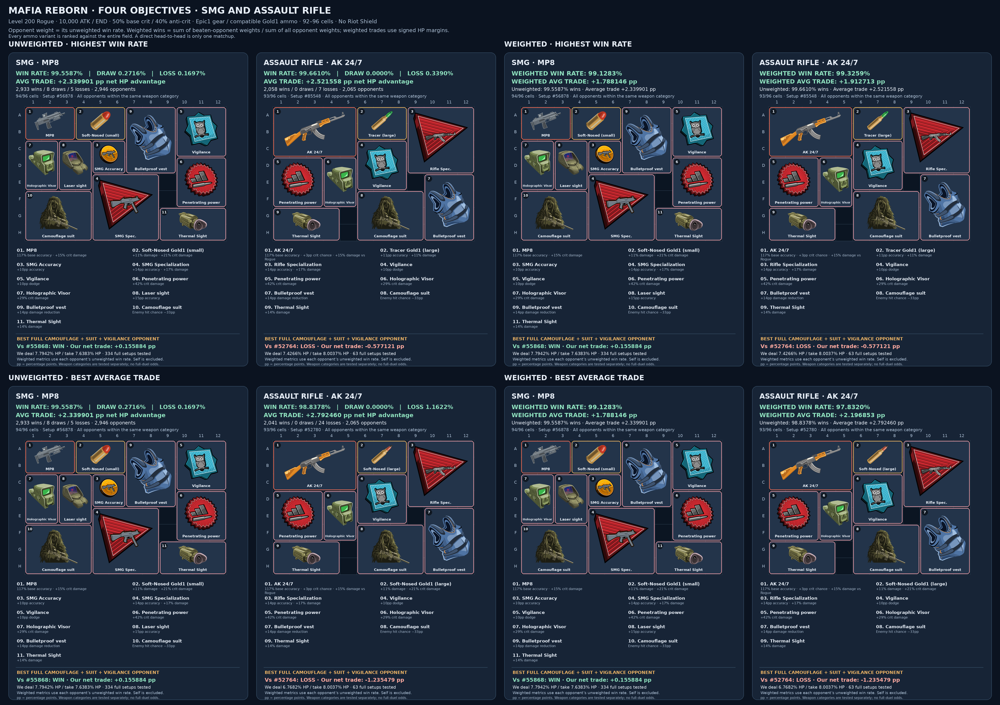

# Mafia Reborn: combat-inventory optimization

A reproducible C++/CUDA study of **one-exchange expected HP advantage**. The CPU
enumerates item sets, CUDA proves whether each inventory fits, and every valid
set is compared with every other valid set in its weapon category. This
repository contains the current experiment and its verified results.

## 1. Class comparison: coefficients, value, and interpretation

The supplied normalized comparison is reproduced by a **level-50 reference
scenario with nominal Epic1 weapons and Epic Vigilance on every class**:

| Class | ATTACK | END | COMBAT | VALUE |
|---|---:|---:|---:|---:|
| Tactician | 2.033× | 0.417× | 84.8% | 0.921× |
| Rogue | 1.000× | 1.000× | 100.0% | 1.000× |
| Bully | 0.607× | 1.693× | 102.8% | 1.014× |

For normalized attack and endurance coefficients $a_c$ and $e_c$, the columns use

```math
\mathrm{COMBAT}_c=100a_ce_c\%,\qquad
\mathrm{VALUE}_c=\sqrt{a_ce_c}.
```

Calculations use the full-precision reconstructed coefficients before rounding
the displayed columns.

VALUE is the geometric-mean scale of the attack–endurance product. Thus Bully's
supplied VALUE is approximately **1.4% above Rogue**, while its product-based
COMBAT score is approximately **2.8% higher**. These are different quantities;
neither is a duel win probability. Bully has a small, steady advantage in this
reference proxy, while Rogue can still win individual fights through favorable
hit, dodge, critical, and damage rolls.

Tactician should **not be classified as generally weaker from this table alone**.
It describes a normalized coefficient comparison, not the complete progression
process. A Tactician can obtain favorable wins against stronger opponents and,
where those wins improve its rewards, acquire better equipment. Such a gear
advantage can reverse an equal-level comparison. This progression argument is
outside the present fixed-equipment analysis; the experiment does not measure
loot acquisition or establish that a class necessarily progresses faster.

### 1.1 Reconstructing the setup behind the reference numbers

Let $h_c$ be the class HP multiplier, $\rho_c$ its base mitigation, $d_c$ its
base dodge, and $\mu_{R,c}$ the mean of its nominal generated weapon range.
The following reconstruction matches **every supplied column at its displayed
precision**:

```math
a_c=\frac{\mu_{R,c}}{\mu_{R,\mathrm{Rogue}}},\qquad
e_c=\frac{h_c/[(1-\rho_c)(1-d_c-0.10)]}
{h_{\mathrm{Rogue}}/[(1-\rho_{\mathrm{Rogue}})(1-d_{\mathrm{Rogue}}-0.10)]}.
```

The 0.10 is **Epic Vigilance**, applied to every class. The matching setup uses
level 50, nominal Epic1 generation with both random generation factors set to
one, and no Vest, Camouflage, Suit, ammo, or other class-dependent buffs. A concrete
matching example uses **1,000 raw Attack and 1,000 raw Endurance**, 50% base crit,
and 40% anti-crit for every class. A common generic SMG category is sufficient:
common accuracy and critical factors cancel. The raw Attack/Endurance scales
cancel in this proxy; these values specify a reproducible matching example,
not uniquely recovered historical inputs. This is an analytical class proxy,
not a 92–96-cell inventory candidate or a complete-fight measurement.

Without Vigilance, level-50 END becomes **0.418921×** for Tactician and
**1.695427×** for Bully, rather than **0.417235×** and **1.693096×**. Vigilance
therefore genuinely changes the comparison. The reconstruction identifies a
consistent setup; the original historical execution log was not supplied.

Keeping Vigilance and repeating the same calculation at **level 200** gives:

| Class | ATTACK | END | COMBAT | VALUE |
|---|---:|---:|---:|---:|
| Tactician | 2.008184× | 0.417235× | 83.7884% | 0.915360× |
| Rogue | 1.000000× | 1.000000× | 100.0000% | 1.000000× |
| Bully | 0.601535× | 1.693096× | 101.8455% | 1.009186× |

Thus the approximately **1.4% Bully VALUE advantage belongs to the reconstructed
level-50 comparison**. At level 200, the same nominal proxy gives about **0.92%**.
The weapon generator's class-dependent additive constants make ATTACK depend on
level. These proxy tables do not change the level-200 Rogue inventory results.

The supplied rounded inputs remain in
[`data/class_reference.json`](data/class_reference.json). A source-based
reconstruction, including the with/without-Vigilance alternatives, is generated
as [`results/class_mechanics.json`](results/class_mechanics.json).

### 1.2 What a skill point buys in each class

The following constants are extracted from the bundled client, independently
of the supplied normalized table:

| Class | HP multiplier $h_c$ | Base dodge | With Epic Vigilance | Base mitigation | With Epic Vest | HP per Endurance at level 200, continuous |
|---|---:|---:|---:|---:|---:|---:|
| Tactician | 2.00 | 7.1% | 17.1% | 10% | 24% | 402.00 |
| Rogue | 3.85 | 10.1% | 20.1% | 25% | 39% | 773.85 |
| Bully | 4.40 | 9.1% | 19.1% | 50% | 64% | 884.40 |

Vigilance and Vest are optional in the inventory search. Their columns above
show the effect **when equipped**, not universal base stats. The exact HP formula
with an Endurance stat buff $b_E$ is

```math
E_{\mathrm{eff}}=\left\lceil E(1+b_E)\right\rceil,\qquad
H_c(E)=\left\lceil E_{\mathrm{eff}}(\ell+1)h_c\right\rceil.
```

The exact one-point increment is $H_c(E+1)-H_c(E)$. Without buffs, the continuous
increment is $k_c=(\ell+1)h_c$ and the integer increment is either
$\lfloor k_c\rfloor$ or $\lceil k_c\rceil$. At level 200 and 10,000 Endurance:

| Class | HP at 10,000 Endurance | Exact HP gained by the next Endurance point |
|---|---:|---:|
| Tactician | 4,020,000 | 402 |
| Rogue | 7,738,500 | 774 |
| Bully | 8,844,000 | 885 |

Endurance raises HP; it does not directly raise dodge or mitigation. A useful
survival proxy against normalized, noncritical incoming attempts with hit chance
one is

```math
\mathrm{EHP}_c=\frac{H_c}{(1-d_c-v)(1-\rho_c)},\qquad
\frac{\partial\mathrm{EHP}_c}{\partial E}
\approx\frac{(\ell+1)h_c}{(1-d_c-v)(1-\rho_c)}.
```

Here $v$ is the equipped Vigilance bonus, and the displayed example has no Vest.
This proxy incorporates expected dodge and mitigation; it is not an exact number
of attacks survived. It ignores the two-damage floor and critical variance.

| Class | Effective HP per Endurance, no Vigilance | Effective HP per Endurance, Epic Vigilance |
|---|---:|---:|
| Tactician | 480.803732 | 538.801769 |
| Rogue | 1,147.719689 | 1,291.364205 |
| Bully | 1,945.874587 | 2,186.402967 |

### 1.3 How class and weapon generation determine Attack's value

The Attack multiplier itself is shared across classes:

```math
A_{\mathrm{eff}}=\left\lceil A(1+b_A)\right\rceil,\qquad
K_A=0.055A_{\mathrm{eff}}(1+b_{\mathrm{damage}}-b_{\mathrm{damageDebuff}}).
```

The class changes the **generated weapon range**, not the constant 0.055.
For generation quality multiplier $q$, class parameters $p_c,b_c$, generation
rolls $U\in[0.99,1.01]$ and $V\in[0.9,1.1]$, and class/quality spread $s_c$:

```math
S_c=(p_c\ell+b_c)qU,\qquad s=s_cV.
```

```math
R_{\min}=\left\lfloor\frac{S_c}{2+s}\right\rfloor.
```

```math
R_{\max}=\mathrm{round}(S_c)-R_{\min}.
```

Combat samples the equipped weapon's **stored** integer range. It does not add
another class damage multiplier to a range that was already generated for a
class. Epic1 uses $q=1.15$ and 117% base accuracy for all three classes.

| Class | $p_c$ per level | $b_c$ additive constant | Epic1 spread $s_c$ | Nominal level-200 Epic1 range | Mean roll $\mu_R$ | Continuous noncritical damage per Attack point |
|---|---:|---:|---:|---:|---:|---:|
| Tactician | 17.0 | 14 | 0.15 | 1,826–2,100 | 1,963.0 | 107.9650 |
| Rogue | 8.5 | 0 | 0.12 | 922–1,033 | 977.5 | 53.7625 |
| Bully | 5.1 | 3 | 0.09 | 562–614 | 588.0 | 32.3400 |

This table sets $U=V=1$ and excludes hit failures, crit, ammo, other damage buffs,
target-specific bonuses, mitigation, and final rounding. The last column is
$0.055\mu_R$, not a claim that every additional Attack point deals that exact
integer damage in every matchup.

**Proposition — the conditional mean is independent of spread.** The generator
defines $R_{\min}+R_{\max}=\mathrm{round}(S_c)$. A uniform integer random
variable over an inclusive interval has mean $(R_{\min}+R_{\max})/2$. Hence

```math
\mathbb{E}[R\mid S_c,s]=\frac{\mathrm{round}(S_c)}{2}.
```

For a fixed $S_c$, spread can change the range and variance, but not its mean.
The mean remains sensitive to the generation roll $U$ and to rounding $S_c$.

For fixed equipment and probability factors, the continuous expected damage
gain from one additional raw Attack point is

```math
\frac{\partial\mathbb{E}[D]}{\partial A}
\approx p_{\mathrm{land}}\,0.055(1+b_A)
(1+b_{\mathrm{damage}}-b_{\mathrm{damageDebuff}})\mu_R
[1+p_{\mathrm{crit}}(m-1)](1+b_{\mathrm{vsClass}})
(1-\rho_d-b_{\mathrm{resistance}}-b_{\mathrm{defense}})\eta,
```

where $\rho_d$ belongs to the **defender**, $m$ is the critical multiplier, and
$\eta=50/[50+\max(0,\ell_d-\ell_a)]$ is the level penalty. This approximation
assumes the damage floor and lethal-hit Rapid-Fire conditions do not change.
The exact discrete gain is obtained by averaging
$D(A+1,R,C)-D(A,R,C)$ over the same integer rolls and critical branches, with the
client's rounding operations retained. At 10,000 Attack, the rounded mean gains
before defense/crit are approximately **107.963636**, **53.767857**, and
**32.339623**, illustrating the difference from the continuous slopes above.

### 1.4 Weapon-type effects and the other skill points

These are the generic **Epic1** weapon-type bonuses in the bundled generator;
named special weapons may override them:

| Weapon type | Extra crit chance | Extra critical damage | Damage against target classes |
|---|---:|---:|---|
| Pistol | — | +15% | — |
| SMG | — | +15% | — |
| Shotgun | — | +25% | +15% vs Tactician; −15% vs Bully |
| Assault rifle | +3 pp | — | +15% vs Rogue; −15% vs Tactician |
| Sniper | +5 pp | — | +15% vs Bully; −15% vs Rogue |

The same raw Luck or Toughness point has the same base formula in every class.
Its combat benefit then depends on the opponent and equipped weapon:

| Raw point | Continuous benefit before its base cap, no stat buff | Level-200 value |
|---|---|---:|
| +1 Luck | $100/(40.38\ell)$ pp base crit | +0.01238237 pp |
| +1 Luck against 40% anti-crit | $100(1-0.40)/(40.38\ell)$ pp effective crit | +0.00742942 pp |
| +1 Toughness | $100/(44.27\ell)$ pp anti-crit | +0.01129433 pp |
| +1 Toughness against 50% attacker crit | $100(0.50)/(44.27\ell)$ pp less effective enemy crit | −0.00564717 pp enemy crit |

These are uncapped continuous slopes, not extra percentages of total damage.
Luck does not increase accuracy, and Toughness does not add class damage
mitigation. The client also has a separate temporary `defenseBuffPerc`: it adds
direct mitigation and adds anti-crit multiplied by $1+\rho_c$. Epic Bulletproof
Vest uses `damageResistancePerc`, so it does **not** receive that extra anti-crit
effect. No such temporary defense buff is active in the measured run.

## 2. Skill-point allocation: what can actually be proved

Let $A$ denote Attack and $E$ Endurance. With level, equipment, critical statistics,
and the opponent fixed, mean outgoing damage is approximately proportional to
$A$, while HP is proportional to $E$. Integer rounding is temporarily omitted
for the continuous derivations below.

### 2.1 A balanced allocation maximizes an attack–survival product

**Theorem — 50/50 is optimal for the expected exchange ratio under a fixed
equal-cost Attack/Endurance budget.** Assume fixed level, equipment, opponent,
and critical statistics, with expected outgoing damage $kA$, incoming damage
$d>0$, own HP $hE$, and fixed enemy HP $H_e$. The normalized exchange ratio is

```math
\mathcal{R}(A,E)=\frac{kA/H_e}{d/(hE)}=\frac{kh}{dH_e}AE.
```

Thus the product objective is mechanically justified for this ratio. Absorbing
all fixed factors into a positive constant gives the product proxy

```math
F(A,E)=K\,a_cA\,e_cE,
\qquad A+E=P,\quad A,E>0,
```

substitution gives $F(A)=Ka_ce_cA(P-A)$. Therefore

```math
\frac{dF}{dA}=Ka_ce_c(P-2A),\qquad \frac{d^{2}F}{dA^{2}}=-2Ka_ce_c<0,
```

so the unique interior optimum is

```math
A_{\mathrm{opt}}=E_{\mathrm{opt}}=\frac{P}{2}.
```

This is a global maximum: the second derivative is negative over the entire
feasible interval. Equivalently,

```math
AE=\frac{(A+E)^2-(A-E)^2}{4}
=\frac{P^2}{4}-\frac{(A-E)^2}{4}\leq\frac{P^2}{4},
```

with equality only at $A=E$. The identity supplies a second proof independent of
the stationary-point calculation. With integer points, the optimal pair is
$\lfloor P/2\rfloor,\lceil P/2\rceil$, in either order.

Writing $A=fP$ gives the exact relative sensitivity $F/F_{\max}=4f(1-f)$:

| Attack / Endurance allocation | Product value relative to the optimum |
|---|---:|
| 50% / 50% | 100% |
| 55% / 45% | 99% |
| 60% / 40% | 96% |
| 70% / 30% | 84% |
| 80% / 20% | 64% |

Constant class multipliers change the attained value, but not this equal-cost
allocation. If one stat point costs $c_A$ and the other $c_E$, with
$c_AA+c_EE=P$, the corresponding result is

```math
A_{\mathrm{opt}}=\frac{P}{2c_A},\qquad E_{\mathrm{opt}}=\frac{P}{2c_E}.
```

This means equal spending, rather than necessarily equal raw stat points. With
existing effective stats $A_0,E_0$ and $x+y=P$ additional equal-cost points,
maximizing $(A_0+x)(E_0+y)$ gives
$x_{\mathrm{opt}}=(P+E_0-A_0)/2$, clipped to $[0,P]$. The unconstrained solution equalizes
the final effective stats.

**Scope of the proof:** this is an attack–survival product, also proportional to
an expected damage-exchange ratio under the stated assumptions. It is not a
proof that 50/50 maximizes every PvP objective.

### 2.2 The single-exchange HP margin has a different allocation optimum

Against a fixed opponent, with fixed accuracy, mitigation, and critical factors,
write outgoing expected damage as $kA$ and incoming expected damage as $d$.
If our HP is $hE$, the measured HP-percentage margin has the continuous form

```math
M(A,E)=\alpha A-\frac{\beta}{E}.
```

```math
\alpha=\frac{100k}{H_{\mathrm{enemy}}},\qquad \beta=\frac{100d}{h}.
```

With $A+E=P$:

```math
M(A)=\alpha A-\frac{\beta}{P-A}.
```

```math
\frac{dM}{dA}=\alpha-\frac{\beta}{(P-A)^{2}}.
```

```math
\frac{d^{2}M}{dA^{2}}=-\frac{2\beta}{(P-A)^{3}}<0.
```

The interior solution is therefore

```math
E_{\mathrm{opt}}=\sqrt{\frac{\beta}{\alpha}},\qquad A_{\mathrm{opt}}=P-E_{\mathrm{opt}}.
```

It must be clipped to the permitted stat bounds. This derivation assumes that
changing HP does not cross a lethal-hit/Rapid-Fire threshold and that the other
combat factors remain fixed. It shows why **equal Attack and Endurance is not a
universal optimum for the HP-margin objective**. The measured inventory run fixes
both at 10,000; it does not optimize skill points.

For example, take $P=20,000$, $\alpha=0.001$, and $\beta=40,000$. The margin
optimum has $E_{\mathrm{opt}}\approx6,324.555$ and $A_{\mathrm{opt}}\approx13,675.445$. It scores about
**7.350889 pp**, whereas 10,000/10,000 scores **6 pp**. This is an algebraic
counterexample, not a new inventory measurement. It disproves a universal
50/50 claim for the net-margin objective while leaving the ratio theorem intact.

The theory test checks the square identity and every integer allocation for
budgets 2 through 250, verifies unequal-cost examples, and compares the margin
optimum with an exhaustive integer search. These checks validate the algebraic
implementation; the proofs themselves are the derivative and identity arguments.

### 2.3 Luck and Toughness: caps and marginal returns

The bundled client uses, without stat buffs,

```math
c(L)=\min\!\left(0.5,\frac{\lceil L\rceil}{40.38\ell}\right)
       +b_{\mathrm{crit}},\qquad
u(T)=\min\!\left(0.4,\frac{\lceil T\rceil}{44.27\ell}\right),
```

where $\ell$ is character level, $L$ Luck, $T$ Toughness, and $u$ anti-crit.
At level 200, integer stats reach the **base** caps at **4,038 Luck** and
**3,542 Toughness** under the exact-decimal mathematical formula, provided there
are no corresponding stat buffs. There is a small implementation edge case:
binary floating-point evaluation of `40.38 * 200` places the result just above
8,076, so 4,038 Luck yields a probability less than 0.5 by less than $10^{-15}$;
**4,039** strictly saturates that floating-point expression. The theory test
records both thresholds. This inventory experiment directly fixes base crit at
50%, so the edge case does not affect its measured results. Weapon
critical-chance bonuses are added after the base cap.

For a landed shot with critical multiplier $m$, expected critical scaling is

```math
G=1+c(L)(1-u_{\mathrm{enemy}})(m-1).
```

Ignoring the ceilings inside an uncapped interval and defining
$q=(1-u_{\mathrm{enemy}})(m-1)$ gives

```math
\frac{\partial\log F}{\partial L}
=\frac{q}{40.38\ell\,[1+q\,c(L)]}.
```

For fixed enemy crit chance $c_e$ and multiplier $m_e$, let
$r=c_e(m_e-1)$. The expected incoming critical factor is
$J=1+r(1-u(T))$. For a product proxy containing survival $1/J$:

```math
\frac{\partial\log F}{\partial T}
=\frac{r}{44.27\ell\,[1+r(1-u(T))]}.
```

Additional Luck or Toughness has zero marginal benefit **through these base
formulas** beyond its cap. Before the cap, the correct choice depends on the
opponent and the critical multiplier. An interior constrained allocation must
equalize marginal gain per point cost:

```math
\frac{1}{c_x}\frac{\partial\log F}{\partial x}=\lambda.
```

Bounds and caps must also be checked. There is no opponent-independent proof
that one should always fill both caps before buying Attack or Endurance.
[`tests/check_theory.py`](tests/check_theory.py) checks the reference arithmetic,
allocation examples, cap thresholds, and basic combat identities.

### 2.4 Which statements are proved, reconstructed, or measured?

| Claim | Status and evidence |
|---|---|
| Class HP, dodge, mitigation, weapon-generation parameters, and generic weapon bonuses | Extracted from the bundled client and checked by `tools/class_math.py`. |
| The supplied 2.033 / 0.417 / 0.607 / 1.693 class coefficients | Reproduced to displayed precision by the level-50 Epic1 + Vigilance reference context; this does not uniquely recover the historical execution. |
| Conditional weapon-roll mean is `round(S)/2` | Exact consequence of the inclusive uniform mean and the generator's endpoint-sum identity. |
| 50/50 maximizes the fixed-budget expected exchange ratio | Exact continuous theorem under the stated fixed-factor/equal-cost assumptions; integer optimum is the floor/ceiling split. |
| 50/50 maximizes the study's net HP margin in general | False: the derivative gives a different optimum, and a concrete counterexample is checked numerically. |
| The selected inventories maximize the four implemented objectives within this item scope | Exhaustive finite-model search: all candidates covered, every packing status resolved, and all scores independently reconstructed. This is not a proof of optimality for unrestricted live gameplay. |
| Tactician's favorable wins can produce a progression/gear advantage | A conditional progression argument, not a result measured by this fixed-stat experiment. |

The packing proof and allocation identities are mathematical arguments. The
audits validate their implementation and the finite numerical calculation;
they are not substitutes for the stated assumptions. The class and inventory
results remain tied to the bundled client snapshot.

## 3. The measured experiment

| Parameter | Value |
|---|---|
| Both characters | Level 200 Rogue |
| Attack / Endurance | 10,000 / 10,000 |
| HP | 7,738,500 |
| Base crit / anti-crit | 50% / 40% |
| Base dodge / mitigation | 10.1% / 25% |
| Weapons | Epic1 MP8; Epic1 AK 24/7 |
| Skills and accessories | Epic1, compatible items only; Riot Shield excluded |
| Ammunition | None, Gold1 Tracer, or Gold1 Soft-Nosed; at most one |
| Caliber | Small for SMG; large for AK/rifle |
| Inventory | 12×8; 92–96 occupied cells; no rotation |
| Comparison | Every valid setup versus every other setup in its own category |

SMG and rifle never fight each other. Every comparison uses **both complete
inventories**. A direct ammo-versus-ammo matchup contributes one opponent result;
the winner is chosen from its performance over the entire field.

This is one mutual attack attempt, evaluated by its expectation. It does not
simulate a complete duel. Food, gangs, houses, vehicles, pets, grenades, healing
consumables, and their timing are outside this experiment.

## 4. Current result figure

The first two columns are unweighted SMG and AK; the last two are weighted SMG
and AK. The top row maximizes win rate; the bottom row maximizes average trade.
Every cell includes item effects and its **individually selected** strongest
complete Camouflage + Camouflage Suit + Vigilance opponent.

[Open the full-resolution figure](results/loadout_comparison.png)



| Selected setup | Win rate | Weighted win rate | Mean net HP advantage | Weighted mean net HP advantage |
|---|---:|---:|---:|---:|
| SMG: all four objectives | 99.5587% | 99.1283% | +2.339901 pp | +1.788146 pp |
| AK: highest win rate | 99.6610% | 99.3259% | +2.521558 pp | +1.912713 pp |
| AK: best average trade | 98.8378% | 97.8320% | +2.792460 pp | +2.196853 pp |

Here **pp** means percentage points of HP. A positive trade means the setup
deals a greater expected fraction of the opponent's HP than it loses itself.
The win rate is the fraction of opponent setups it beats **on this expected
trade**, not the probability of winning an actual duel.

## 5. Findings and close alternatives

### 5.1 Why only the AK ammunition changes between the selected maxima

The selected AK win-rate and average-trade winners share all their non-ammo
items. Tracer supplies +11 pp accuracy; Soft-Nosed supplies +21% critical damage.
Both Gold1 rounds also supply +11% damage.

Switching this AK from Tracer to Soft-Nosed reduces its unweighted win rate by
**0.823245 pp**, but improves its average net HP margin by **0.270902 pp**
(about **10.74% relative**). Its weighted average margin improves by
**0.284140 pp** (about **14.86% relative**), while weighted win rate falls by
**1.493874 pp**. The correct choice therefore depends on the objective.

### 5.2 A substantially different AK is only one win behind

The following rows share the remaining weapon, specialization, Vigilance,
Penetrating Power, Bulletproof Vest, and Thermal Sight:

| Ammo and distinguishing items | Wins / 2,065 opponents | Win rate | Mean net HP advantage |
|---|---:|---:|---:|
| Tracer + Holographic Visor + Camouflage Suit | **2,058** | **99.6610%** | +2.521558 pp |
| Soft-Nosed + Holographic Visor + Camouflage Suit | 2,041 | 98.8378% | **+2.792460 pp** |
| Soft-Nosed + Rapid Fire + Tactical Sight | 2,057 | 99.6126% | +2.633986 pp |

The Rapid-Fire alternative has a **better average trade than the win-rate
winner**, but a **worse average trade than the average-trade winner**. This is
why it is not selected for either maximum. It is a close compromise: one fewer
win than the win-rate leader, together with a better average HP margin.

The exact maximum should not hide the existence of materially different,
near-optimal inventories.

### 5.3 The SMG solution is stable, with a close alternative

All four objectives select the same SMG item set. Its nearest different-gear
alternative removes SMG Accuracy and Camouflage Suit and adds Universal
Accuracy. It reaches **99.4229% win rate** and **+2.318956 pp** average trade,
versus **99.5587%** and **+2.339901 pp** for the selected winner.

The selected SMG has 156% accuracy before the enemy's camouflage. Camouflage
and Suit subtract 55 pp, leaving 101%, which is clamped to 100% before dodge.
Against a full camo–suit–Vigilance defender, this gives:

| Selected setup | Accuracy after camouflage, before dodge | Actual landed-shot probability |
|---|---:|---:|
| SMG winner | 100% | 79.900% |
| AK with Tracer | 87% | 69.513% |
| AK with Soft-Nosed | 76% | 60.724% |

This explains an important difference in their response to camouflage. It does
not establish an SMG-versus-AK duel ranking: their result tables use separate
opponent fields.

### 5.4 Weighting changes rankings, even when the winners remain the same

The win-rate and average-trade rank correlations are approximately **0.9982**
for SMG and **0.9981** for rifle. The objectives largely agree in this field.
Weighting moves **2,822 SMG** and **1,934 rifle** setups in the win-rate order,
and **2,876 SMG** and **1,984 rifle** setups in the average-trade order. The
selected maxima nevertheless remain the same and have unique primary scores.

The independent recheck also includes a synthetic tournament where weighting
changes the unique winner. Unchanged winners are a property of these inputs,
not a requirement built into the code.

### 5.5 Full defensive-core counter-setups are a separate sensitivity check

For each of the eight selected cells, all valid complete inventories containing
**Camouflage, Camouflage Suit, and Vigilance simultaneously** are examined.
The strongest counter is selected separately for that specific target by its
expected HP margin. It is not a shared, fixed three-item opponent.

| Selected target | Full core setups tested | Core setups that beat it | Target's margin against its strongest core opponent |
|---|---:|---:|---:|
| SMG: either selection criterion, weighted or unweighted | 334 | 0 | +0.155884 pp |
| AK: win-rate winner, weighted or unweighted | 63 | 2 | −0.577121 pp |
| AK: average-trade winner, weighted or unweighted | 63 | 7 | −1.235479 pp |

The strongest AK counter uses Soft-Nosed Large, Rifle Specialization, Vigilance,
Camouflage, Holographic Visor, Bulletproof Vest, Camouflage Suit, and Thermal
Sight with its AK. Compared with the average-trade AK winner, it replaces
Penetrating Power with Camouflage. This single 3×3 substitution demonstrates
that an overall winner can still have a meaningful targeted weakness.

Full item lists and per-item effects are in
[`results/selected_setups_report.md`](results/selected_setups_report.md).
The uniform distribution over all valid item sets, and its win-rate-weighted
variant, describe this experimental field. Actual opponent usage frequencies
may produce different optimal choices.

## 6. Combat equations used by the implementation

Let $s_a$ and $s_d$ be the sums of compatible active attacker and defender item
effects. Different item IDs can stack; identical IDs occur at most once.

**Hit and dodge are separate checks.** Camouflage reductions are added before
accuracy is clamped:

```math
p_{\mathrm{hit}}=\mathrm{clamp}(1.17+s_a^{\mathrm{accuracy}}-s_d^{\mathrm{camouflage}},0,1),
\qquad p_{\mathrm{land}}=p_{\mathrm{hit}}\left[1-\mathrm{clamp}(0.101+s_d^{\mathrm{dodge}},0,1)\right].
```

Epic Camouflage is −22 pp hit chance, Suit −33 pp, Vigilance +10 pp dodge.
For 117% accuracy against all three, $p_{\mathrm{land}}=0.62\times0.799=0.49538$.

**Critical chance after Toughness:**

```math
p_{\mathrm{crit}}=(0.50+s_a^{\mathrm{critChance}})(1-0.40).
```

The SMG therefore has 30% effective crit; the Epic AK's intrinsic +3 pp gives
31.8%. Critical damage multiplies the rolled hit by
$m=2+s_a^{\mathrm{critDamage}}$, not $2(1+s_a^{\mathrm{critDamage}})$.

**HP and rounded damage:**

```math
H=\left\lceil E(\ell+1)3.85\right\rceil,
\quad
D_0=\mathrm{round}\!\left[0.055\lceil A\rceil(1+s_a^{\mathrm{damage}})R\,m\,(1+s_a^{\mathrm{vsRogue}})\right],
```

```math
D=\mathrm{round}\!\left[\max\{2,D_0(1-0.25-s_d^{\mathrm{resistance}})\}\right].
```

Here $m=1$ for a noncritical hit. Rogue mitigation is 25%; Epic Vest adds
14 percentage points, giving 39% total reduction and a **0.61** damage factor.
Damage buffs add before multiplication. The Epic AK adds +15% damage versus
Rogue, while the Epic MP8 adds +15% critical damage.

The nominal Epic1 Rogue weapon range at level 200 is **922–1,033**, generated
from $r=8.5\ell\times1.15$, $R_{\min}=\lfloor r/2.12\rfloor$ and
$R_{\max}=\mathrm{round}(r)-R_{\min}$. All integer rolls and both critical
branches are summed. Concrete game-generated weapons may differ from this
nominal range; their individual random generation rolls are not inputs here.

**Rapid Fire:** on a landed, nonlethal first hit, Epic Rapid Fire has 17%
probability of adding $\mathrm{round}(DU)$ damage for
$U\sim\mathrm{Uniform}(0.1,0.2)$. The bonus has no separate hit, dodge, or crit
roll. The code integrates the rounded bonus analytically. Before rounding, its
expected increase on an eligible hit is $0.17\times0.15=2.55\%$.

Fast Reaction and Heartbeat Sensor affect initiative, which is inactive in a
mutual one-exchange metric. Medic has no direct effect without healing. These
items remain in the candidate space; the 92-cell minimum can admit neutral
fillers. Ammunition is active from the start of the exchange.

The bundled [`data/client/`](data/client/) fragments allow these formulas to be
reviewed against the supplied snapshot. No assertion about a later live-server
revision is required to reproduce this offline run.

## 7. Four ranking objectives

For two different valid setups $i,j$, define

```math
n_{ij}=100\frac{\mathbb{E}[D_{i\to j}]}{H_j}-100\frac{\mathbb{E}[D_{j\to i}]}{H_i}.
```

Let $b_{ij}=1$ if $n_{ij}>10^{-10}$ percentage points and $0$ otherwise. A draw
has $|n_{ij}|\leq10^{-10}$. Self-play is excluded.

```math
\mathrm{WR}_i=\frac{\sum_{j\ne i}b_{ij}}{N-1},\qquad
\overline{n}_i=\frac{\sum_{j\ne i}n_{ij}}{N-1}.
```

Opponent strength is frozen from its **unweighted** full-field win rate:
$w_j=\mathrm{WR}_j$. There is no recursive weighting.

```math
\mathrm{WWR}_i=\frac{\sum_{j\ne i}w_jb_{ij}}{\sum_{j\ne i}w_j},\qquad
\overline{n}_i^{(w)}=\frac{\sum_{j\ne i}w_jn_{ij}}{\sum_{j\ne i}w_j}.
```

A 99%-win-rate opponent has 99 times the weight of a 1% opponent. Draws remain
in the denominator and contribute zero win credit. Signed losses remain in
the average. An opponent with zero win rate has zero weight; if every opponent
has zero weight, the implementation falls back to uniform weights.

Win-rate ties are broken by the corresponding average trade, and average-trade
ties by the corresponding win rate; the final tie-break is the candidate ID.
Candidate IDs identify item sets within this fixed input order.

## 8. Exhaustive enumeration and exact inventory packing

Each category has 15 optional compatible Epic1 skills/accessories and three
ammo choices including none: $3\times2^{15}=98,304$ CPU-generated selections.

| Stage | SMG | AK / rifle |
|---|---:|---:|
| Before area filtering | 98,304 | 98,304 |
| Area 92–96 only | 7,852 | 9,616 |
| Proven packable | 2,947 | 2,066 |
| Opponents per valid setup | 2,946 | 2,065 |

CUDA assigns one active thread to each area-qualified set, with padded threads
returning immediately. A three-word bitboard represents the 96 cells. At the
first empty cell, the search tries every distinct remaining rectangle shape
starting there, or marks a permitted empty cell. Any rectangle covering that
cell must start there: an earlier origin would overlap a previously occupied
cell or a deliberately reserved hole. Equal-sized rectangles are interchangeable.
This makes the fixed-orientation search complete.

The 0–4 unused cells are explicit holes. A per-pass node budget pauses and
resumes the saved DFS state; a timeout is never classified as impossibility.
The CPU retains successful inventories only after all searches finish, and
independently checks every returned placement for bounds and overlaps.

## 9. Reproduce the complete run

Requirements: a CUDA-capable NVIDIA GPU and compatible CUDA Toolkit/host C++
compiler, CMake 3.24+, Python 3.11+, and DejaVu Sans regular/bold fonts. The
checked Python package versions are pinned in [`requirements.txt`](requirements.txt).
The workflow was validated with Python 3.13. All input data and figure artwork
are local. The C++ executable itself has no Python runtime dependency.

From the repository root:

```bash
python3 -m venv .venv
source .venv/bin/activate
python -m pip install -r requirements.txt
python tools/reproduce.py
```

The script uses `g++-11` when available; otherwise CMake selects the compiler.
For an explicit CUDA-compatible host compiler or architecture:

```bash
python tools/reproduce.py --host-compiler /usr/bin/g++-11 --architecture native --jobs 4
```

`--architecture` accepts CMake CUDA architecture values. Use a numeric
architecture if native detection is unavailable. On Debian/Ubuntu, install the
`fonts-dejavu-core` package if figure generation cannot find DejaVu Sans.

The command configures/builds C++, runs CTest, verifies the ammo and Rapid Fire
snapshot definitions, regenerates every candidate and placement, scores all
pairings, runs both independent audits, recomputes all eight defensive-core
opponents, regenerates the findings, and draws **one canonical figure**.
It writes build files and caches inside the repository and updates the single
`results/` directory. After installing the dependencies, the workflow needs no
network connection.

To inspect the checked-in result without a GPU:

```bash
python tests/check_theory.py
python tools/verify_ammunition.py
python tools/verify_rapid_fire.py
OPENBLAS_NUM_THREADS=1 python tests/audit_results.py
OPENBLAS_NUM_THREADS=1 python tests/recheck_weighted_ranking.py
python tools/analyze_defensive_core.py
python tools/analyze_findings.py
python tools/render_results.py
```

The CPU audit checks every distinct rectangle multiset with SciPy/HiGHS MILP,
every placement, and every score. The additional recheck constructs its own
complete outcome matrix and derives opponent weights **before reading GPU
scores**. It also checks uniform-weight equivalence, the 99:1 example, and a
synthetic tournament whose unique winner changes under weighting.

## 10. Repository contents

| Path | Purpose |
|---|---|
| `src/` | C++ model, complete packing search, CUDA ranking kernels |
| `data/` | Fixed catalog, variants, reference class coefficients, client fragments |
| `assets/` | Local original item illustrations used in the figure |
| `evidence/` | Extracted item/compatibility proofs and large-ammo SVG |
| `tools/` | Input export, complete reproduction, counter-analysis, rendering |
| `tests/` | Theory checks and two independent numerical/packing audits |
| `results/` | This run's results only |

The main result files are:

- [`loadout_comparison.png`](results/loadout_comparison.png): the complete 4×2 grid.
- [`selected_setups_report.md`](results/selected_setups_report.md): winner and counter item effects.
- `*_candidates.csv`: every area-qualified selection and its proven packing status.
- `*_valid_setups.jsonl`: every valid placement and all four scores.
- `*_rankings.csv`: full rankings and score columns; `*_results.json`: the four maxima.
- [`full_defensive_core_vs_champions.json`](results/full_defensive_core_vs_champions.json): eight independently selected core counters.
- [`objective_sensitivity_analysis.json`](results/objective_sensitivity_analysis.json): correlations and different-gear alternatives.
- [`weighted_ranking_recheck.json`](results/weighted_ranking_recheck.json): CPU-only reconstruction and winner margins.
- [`audit.json`](results/audit.json), [`theory_checks.json`](results/theory_checks.json), and
  [`run_manifest.json`](results/run_manifest.json): verification and input hashes.
- [`class_mechanics.json`](results/class_mechanics.json): source-derived class constants,
  level-50 reconstruction, level-200 per-point values, and checks showing why
  omitting Vigilance or changing the reference level does not reproduce the supplied table.

Raw logs and build products are ignored by Git. There are no archived result
trees or alternative figures in the repository. No remote publication is part
of the reproduction command.
